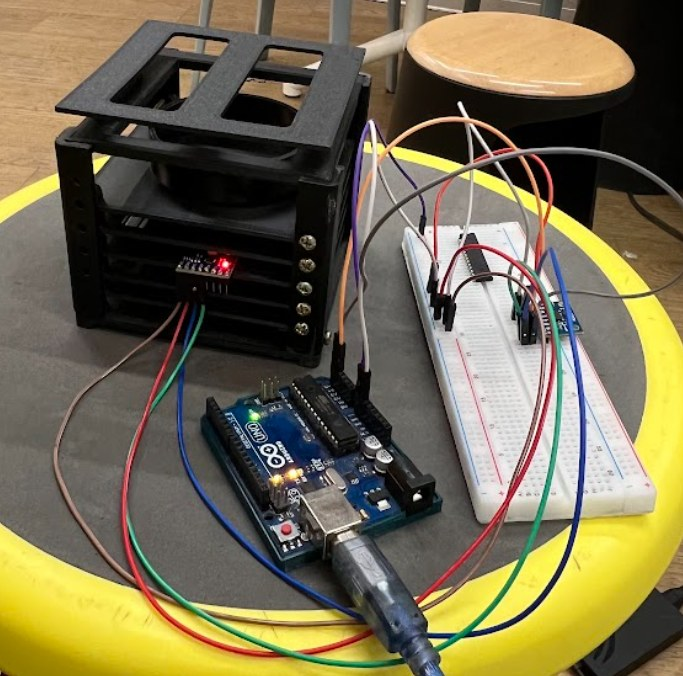
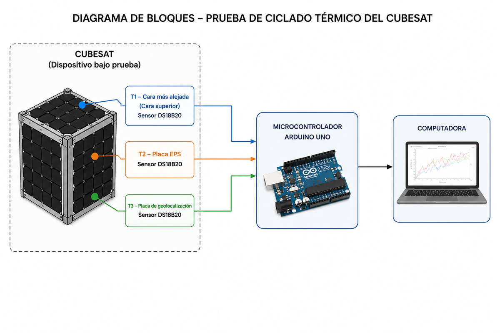
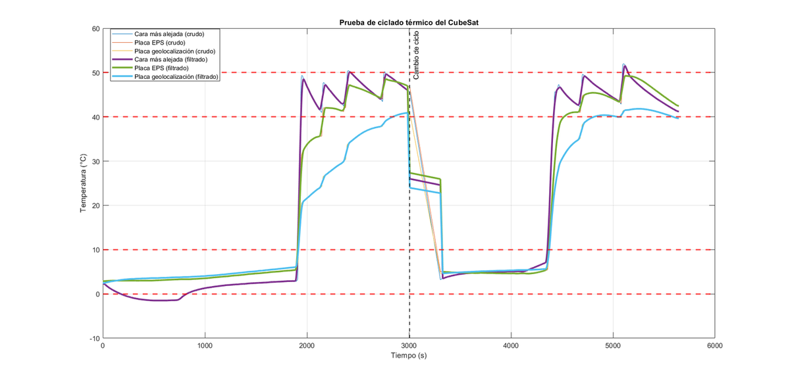
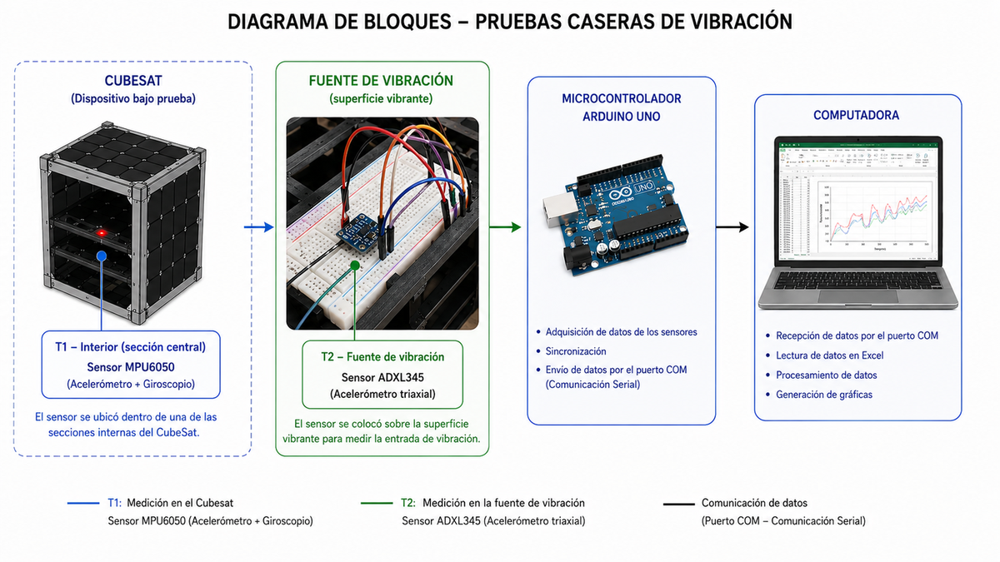
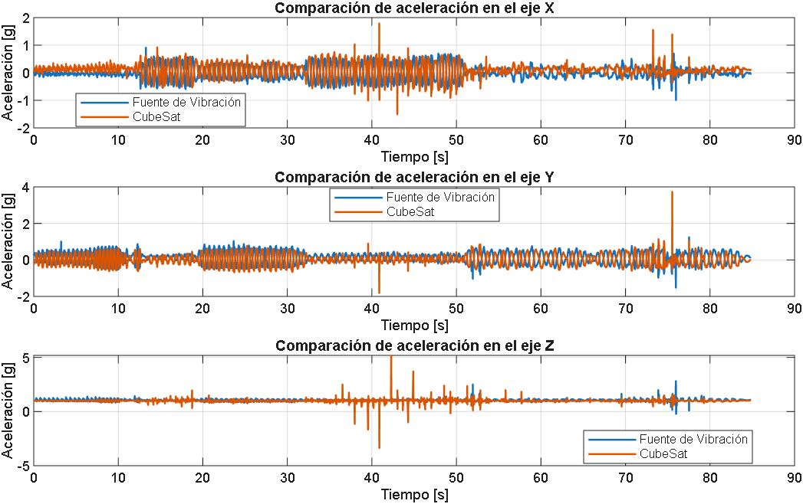
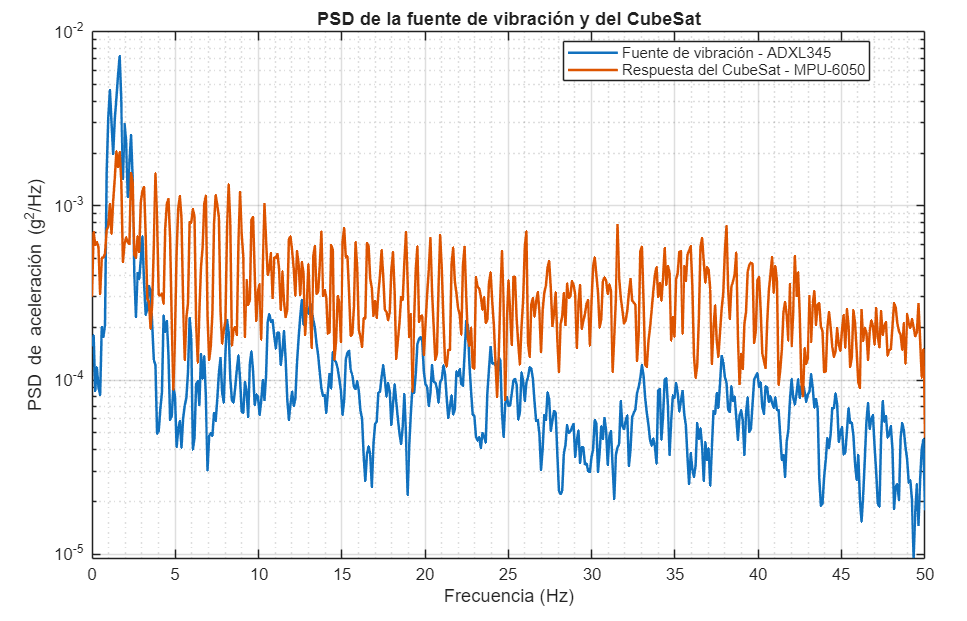
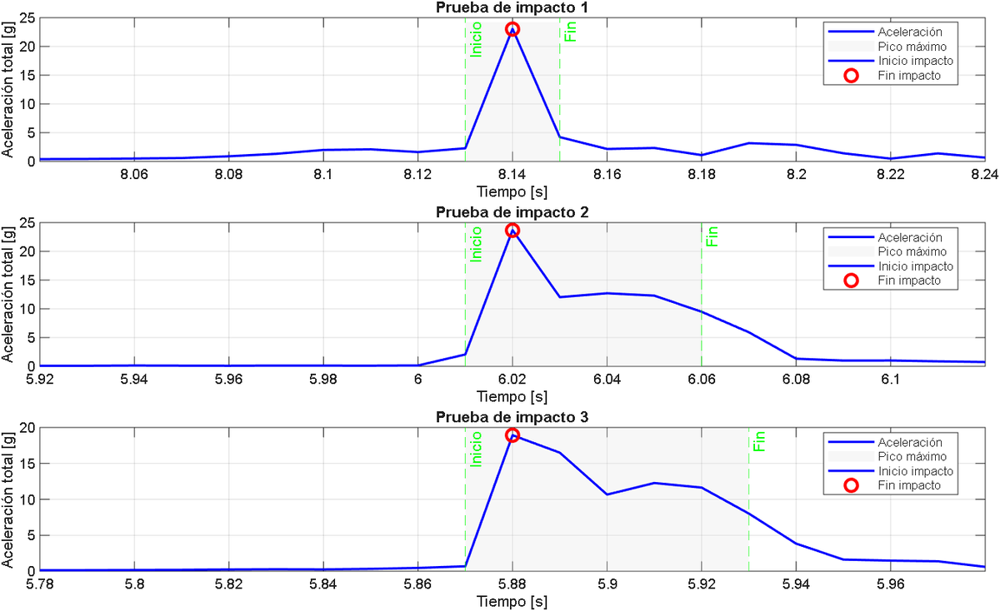
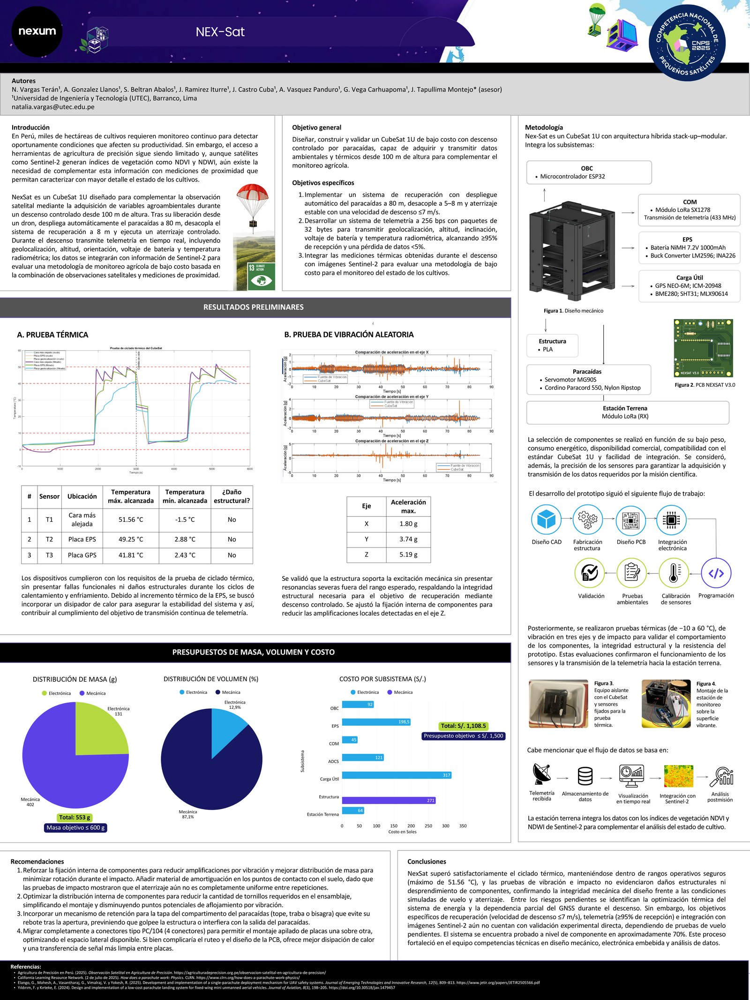

# NEX-Sat (Team NEXUM) — 1U CubeSat Prototype & Environmental Qualification

> Mechanical design, assembly, Arduino-based data acquisition (DAQ), and environmental qualification (**thermal cycling, random vibration + PSD analysis, and mechanical impact**) for **NEX-Sat**, a 1U CubeSat prototype by **Team NEXUM (UTEC)** — ranked among the **24 national finalists out of 200+ participants** at Peru's National Small Satellite Competition (**CNPS — PUCP**).

  

---

## Mission Overview

**NEX-Sat** is a low-cost **1U CubeSat** designed to complement **Sentinel-2** satellite imagery (NDVI/NDWI vegetation indices) for precision agriculture in Peru. Released from a drone at **100 m altitude**, it automatically deploys a parachute at **80 m** (descent rate $\le 7\text{ m/s}$), detaches at **5–8 m**, and streams live geolocation, altitude, attitude, battery voltage, and radiometric/ambient thermal telemetry to a ground station.

### System Architecture & Budgets

| Subsystem | Hardware Specification |
| :--- | :--- |
| **OBC** | `ESP32` microcontroller |
| **COM (Telemetry)** | `LoRa SX1278` at `433 MHz` (256 bps, 32-byte packets, target $\ge 95\%$ reception) |
| **EPS** | `7.2 V 1000 mAh` NiMH battery, `LM2596` buck converter, `INA226` power monitor |
| **Payload** | `GPS NEO-6M`, `ICM-20948` IMU, `BME280`, `SHT31`, `MLX90614` IR radiometric sensor |
| **Recovery & Structure** | 3D-printed PLA 1U hybrid stack-up/modular chassis, custom `NEXSAT V3.0` PCB, `MG90S` servo + ripstop nylon parachute |
| **Mass & Cost Budgets** | **553 g** total (target $\le 600\text{ g}$: 402 g mechanical / 131 g electronics) · **S/. 1,108.5** total cost (budget $\le \text{S/. } 1,500$) |

---

## Qualification Summary

| Test Campaign | Sensors & Sampling | Peak Measured Load / Range | Structural Damage / Failure |
| :--- | :--- | :---: | :---: |
| **Thermal Cycling** | 3× `DS18B20` (Reference face, EPS board, GPS board) | **`-1.5 °C` to `51.56 °C`** | **None (Pass)** |
| **Random Vibration** | `ADXL345` (source) + `MPU6050` (internal CubeSat), **100 Hz** (8,477 samples / 84.85 s) | **`5.19 g`** (`5.1862 g` Z-axis) | **None (Pass)** |
| **Mechanical Impact** | Tri-axial accelerometer over 3 impact trials | **`23.7 g`** max (mean `21.90 g`, CV `11.86%`) | **None (Pass)** |

---

## Experimental Qualification

### 1. Thermal Cycling Test
Three `DS18B20` channels monitored thermal gradients across the chassis and critical electronics:
- **T1 (Reference external face):** `-1.50 °C` to `51.56 °C`
- **T2 (EPS board):** `2.88 °C` to `49.25 °C` *(highest thermal retention; led to adding heat-dissipation & insulation recommendations)*
- **T3 (GPS board):** `2.43 °C` to `41.81 °C`

  
  

### 2. Random Vibration & Power Spectral Density (PSD)
An **Arduino Uno** DAQ recorded synchronized tri-axial acceleration at **100 Hz** from an external `ADXL345` on the excitation surface and an internal `MPU6050` inside the CubeSat:
- **Vibration Source Peaks:** $X_{\max} = 0.92\text{ g}$, $Y_{\max} = 2.92\text{ g}$, $Z_{\max} = 2.83\text{ g}$
- **CubeSat Response Peaks:** $X_{\max} = 1.80\text{ g}$, $Y_{\max} = 3.74\text{ g}$, **$Z_{\max} = 5.19\text{ g}$**
- **PSD Analysis (8,477 samples):** Source dominant frequency at **1.66 Hz** ($7.25 \times 10^{-3}\text{ g}^2/\text{Hz}$) vs. CubeSat dominant response at **1.47 Hz** ($2.06 \times 10^{-3}\text{ g}^2/\text{Hz}$), confirming structural integrity without fastener loosening.

  

  
  

### 3. Mechanical Impact Test
Three consecutive impact trials validated mechanical robustness under high-g shock pulses:
- **Trial 1:** `23.07 g` (`0.02 s` pulse) · **Trial 2:** **`23.70 g`** (`0.05 s`) · **Trial 3:** `18.92 g` (`0.06 s`)
- **Statistics:** Mean = `21.90 g`, Standard Deviation = `2.60 g`, Coefficient of Variation = `11.86%` — **zero structural damage**.

  

---

## Official CNPS 2025–26 Scientific Poster

  

- **Test Evidence (Google Drive):** [Thermal Cycling Campaign](https://drive.google.com/drive/folders/1W9v2WBVZkS5J58PRpF3NiBOIG87eK-WQ?usp=sharing) · [Vibration & Impact Campaign](https://drive.google.com/drive/folders/1k3WpjdRP-ABrE3Re2_voTDYg1N0EHyz9?usp=sharing)

---

## Team & Context

- **Competition:** National Small Satellite Competition (CNPS — PUCP), National Finalists (Top 24 / 200+ participants)
- **Institution:** University of Engineering and Technology (UTEC), Lima, Peru
- **Team NEXUM:** N. Vargas Terán, A. Gonzalez Llanos, S. Beltran Abalos, J. Ramirez Iturre, J. Castro Cuba, A. Vasquez Panduro, G. Vega Carhuapoma · **Advisor:** Prof. J. Tapullima Montejo
